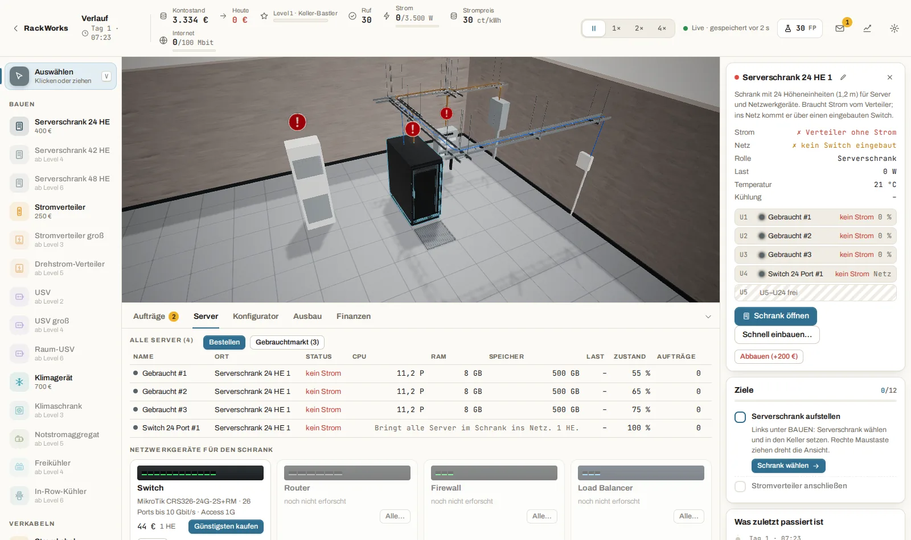
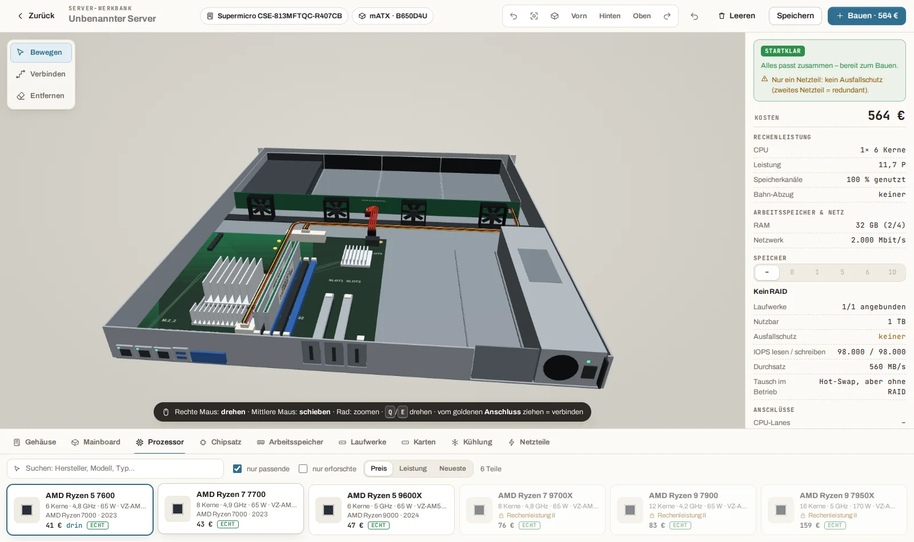
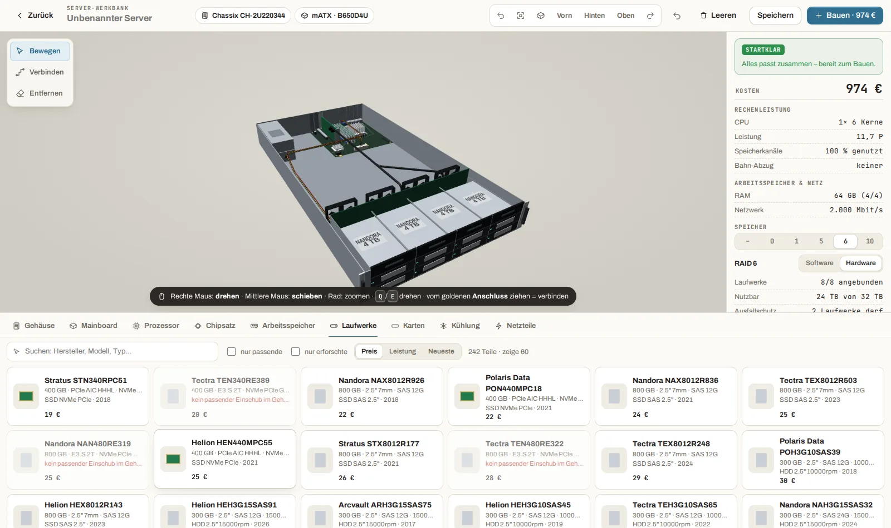
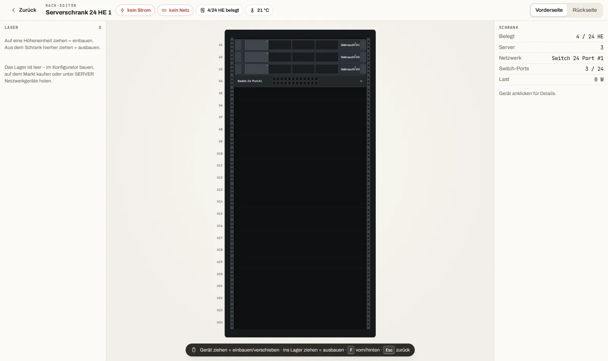
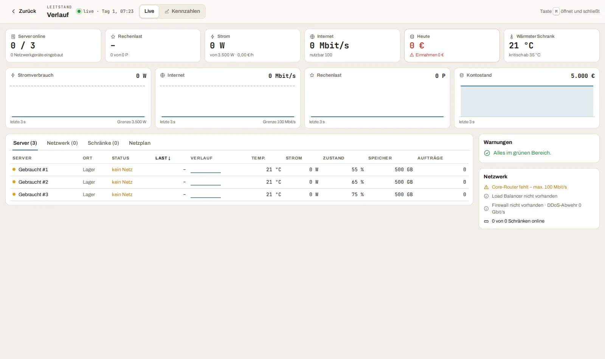
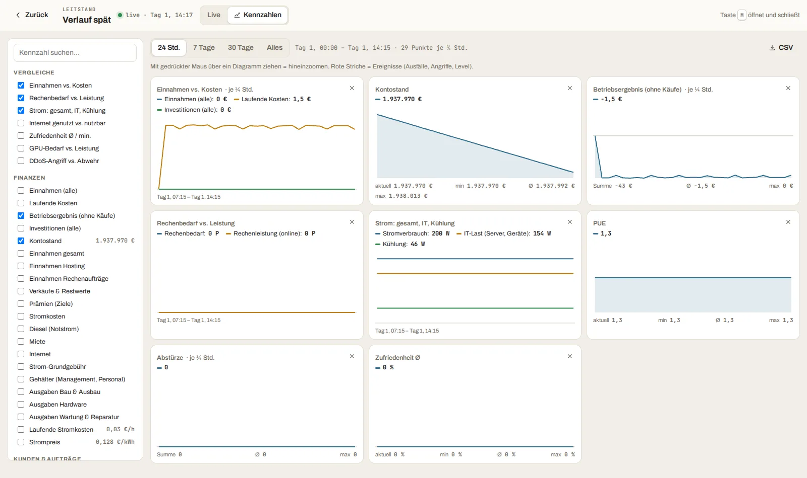
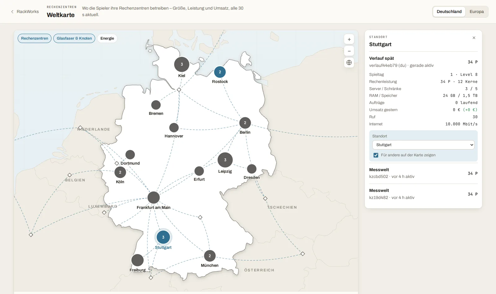
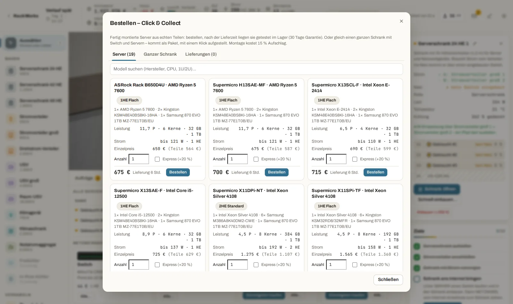
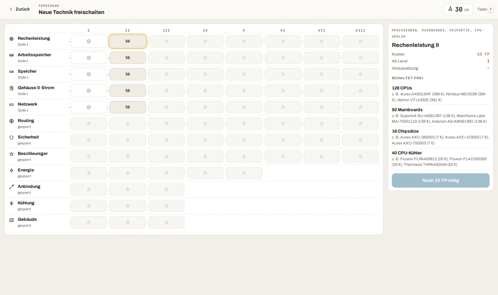

# RackWorks

**Design the circuit. Build the machine. Power the datacenter.**

RackWorks ist ein Rechenzentrum-Aufbauspiel im Browser. Du fängst im Keller mit einem gebrauchten Schrank an
und baust dich bis zum eigenen RZ-Campus hoch: Server aus **echten Teilen** zusammenstecken, Schränke bestücken,
Strom, Kühlung und Netz planen, Aufträge von Kunden erfüllen – und dafür sorgen, dass nichts ausfällt.

> **Mitspielen:** Den Link zur Testversion gibt es mit dem [Tester-Zugang](../../issues/new?template=tester.yml).
> Frühe Testversion – es ändert sich fast täglich etwas. Spielstände liegen auf dem Server, du kannst von jedem Gerät
> weiterspielen.

Dieses Repository enthält **keinen Quellcode**. Es ist der Treffpunkt für alle, die RackWorks spielen und testen:
hier steht, was das Spiel kann, woran gerade gearbeitet wird – und hier könnt ihr Fehler melden, Ideen einreichen
und einen Tester-Zugang anfragen.

## Wo finde ich was?

| Ich will … | Hier |
|---|---|
| wissen, was das Spiel schon kann | [FEATURES.md](FEATURES.md) |
| sehen, woran gerade gearbeitet wird und was geplant ist | [ROADMAP.md](ROADMAP.md) |
| wissen, was zuletzt neu dazukam | [NEUIGKEITEN.md](NEUIGKEITEN.md) |
| mitspielen / testen – und worauf ich achten soll | [TESTEN.md](TESTEN.md) |
| **einen Fehler melden** | [Neues Issue → „Fehler melden“](../../issues/new?template=fehler.yml) |
| **eine Idee einreichen** | [Neues Issue → „Idee / Wunsch“](../../issues/new?template=idee.yml) |
| **Tester werden** | [Neues Issue → „Tester-Zugang“](../../issues/new?template=tester.yml) |
| allgemeines Feedback geben | [Neues Issue → „Feedback“](../../issues/new?template=feedback.yml) |

## Ein paar Eindrücke

| | |
|---|---|
|  **Werkbank:** Server aus echten Teilen in 3D zusammenbauen |  **Speicher:** Schächte, Backplanes, RAID, Kabel |
|  **Rack-Editor:** Schrank von vorn und hinten bestücken |  **Leitstand:** alle Server, Last, Temperatur, Zustand |
|  **Kennzahlen:** Verlauf ab Tag 1, Zoom, Vergleiche, CSV |  **Weltkarte:** Standorte, Glasfaser, Bestenliste |
|  **Click & Collect:** fertige Server und Schränke bestellen |  **Forschung:** neue Teile und Ausbauten freischalten |

## Kurz zur Technik (für Neugierige)

Läuft komplett im Browser (3D mit WebGL), ohne Installation. Die Simulation läuft auf dem Server –
deshalb siehst du auf Handy, Laptop und PC live denselben Stand. Hat dein Rechner Probleme mit der 3D-Grafik,
schaltet das Spiel automatisch auf eine sichere Darstellung um (mehr in [TESTEN.md](TESTEN.md)).

---

*RackWorks ist ein privates Hobbyprojekt in einer frühen Phase. Hardware-Namen gehören ihren Herstellern und
werden nur verwendet, um echte Bauteile abzubilden.*
